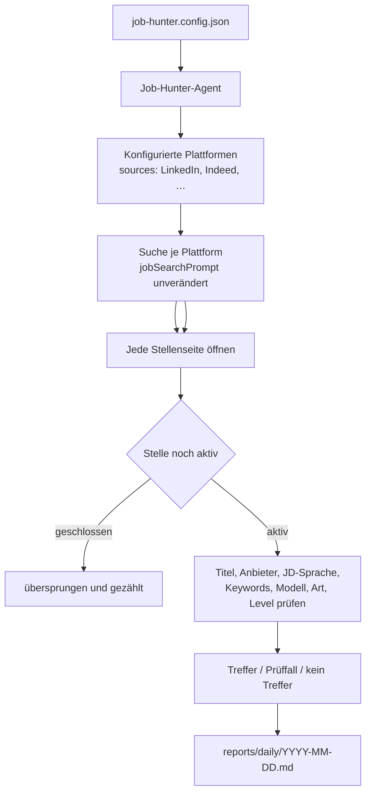

# Job Hunter

**Sag OpenCode, welche Stelle du suchst. Es durchsucht die in `sources` konfigurierten Job-Plattformen – LinkedIn und jede andere Seite, die dein Browser erreicht – öffnet jede verbleibende Anzeige, filtert sie nach deiner Konfiguration und schreibt eine tägliche Markdown-Auswahl.**

[English](README.md) · [简体中文](README.zh-CN.md) · **Deutsch**

## 1. Was es tut

Job Hunter besteht aus drei Teilen: einer OpenCode-Agent-Anweisung, drei Skill-Anweisungen und einer persönlichen Konfigurationsdatei. Es gibt keinen Anwendungscode – kein Backend, keine Datenbank, kein CLI, keine CI und kein API-Key.

Ein Lauf erledigt vier Dinge:

1. **Suchen** – mit dem einen Satz in `jobSearchPrompt` wird jede Plattform aus `sources` genau einmal durchsucht.
2. **Eingrenzen** – in der jeweiligen Filterleiste werden Veröffentlichungsdatum, Anstellungsart, Arbeitsmodell, Seniorität und Ort aus deiner Konfiguration gesetzt.
3. **Prüfen** – jede verbleibende Anzeige wird als echte Stellenseite geöffnet (nicht nur als Ergebniskarte); geschlossene Anzeigen und solche ohne Bewerbungsmöglichkeit werden übersprungen.
4. **Bewerten und berichten** – jede Stelle wird als Treffer, Prüffall oder Nicht-Treffer eingeordnet und in `reports/daily/YYYY-MM-DD.md` gespeichert.

Es bewirbt sich nie für dich, schreibt keine Recruiter an und ändert keine Kontoeinstellungen. Es nutzt die Browser-Sitzung, in der du bereits angemeldet bist.

## 2. So funktioniert es



Die Prüfungen laufen in fester Reihenfolge und enden beim ersten bestätigten Widerspruch. Reicht die Seite nicht aus, um Übereinstimmung oder Widerspruch zu belegen, landet die Stelle im **Prüffall** statt im Ausschluss.

## 3. Was du brauchst

| Voraussetzung | Hinweis |
|---|---|
| OpenCode | installiert und in diesem Repository geöffnet |
| Browser-Tool | eine in OpenCode aktivierte Browser-Integration; dieses Repository installiert oder konfiguriert keine |
| Job-Plattformen | jede Plattform aus `sources`, in diesem Browser bereits angemeldet |
| Sonstiges | nichts – kein Node.js, npm, keine Datenbank, keine CI |

## 4. Schnellstart

```bash
cp job-hunter.config.example.json job-hunter.config.json
```

Bearbeite dann `job-hunter.config.json` (per Git ignoriert, deine Einstellungen bleiben lokal):

1. **`jobSearchPrompt`** – ein Satz in natürlicher Sprache: wo, welche Rolle, welcher Stack, wie aktuell. Das ist die einzige Suchanfrage, die eine Plattform erhält.
2. **`countries` / `locations`** – wo gesucht wird. Leere `locations` bedeutet das ganze Land.
3. **`jobTitles.include`** – die akzeptierten Stellentitel, verwendet für den Abgleich.
4. **`jdLanguages.include`** und **`technicalKeywords`** – die Sprache und der Stack, mit denen du arbeiten kannst.
5. Optional: `workModes`, `employmentTypes`, `seniority`, `excludeRecruiters`.

Dann:

1. Öffne diesen Ordner in OpenCode.
2. Wähle den **Job Hunter**-Primary-Agent (`Tab` wechselt den Agenten).
3. Frage einfach, z. B. *„Finde die Stellen von heute“* oder *„Bericht aktualisieren, nur remote“*.
4. Der Agent steuert den Browser und schreibt `reports/daily/YYYY-MM-DD.md`. Öffne die Datei und lies die Tabellen.

Du sprichst immer nur mit dem Job-Hunter-Agenten. Er lädt `job-discovery` selbst; du wählst nie manuell einen Skill.

> **Nur eine Anfrage.** `jobSearchPrompt` wird unverändert gesendet und nicht aus der Konfiguration umgeschrieben. Ort und Stack gehören in diesen Satz. `jobTitles` und `technicalKeywords` dienen dem *Abgleich*, nicht der *Suche*.
>
> **Filter kommen aus der Konfiguration, nicht aus dem Prompt.** „Letzte 24 Stunden“ im Prompt ist unzuverlässig; der Agent setzt den Filter „Veröffentlichungsdatum“ der Plattform aus `lookbackHours` und prüft vor dem Lesen der Ergebnisse, ob er aktiv ist.

## 5. Suche konfigurieren

| Feld | Pflicht | Wirkung |
|---|---|---|
| `countries` | ja | Landesweiter Suchumfang, z. B. `["Germany"]`. Dient der Prüfung und Beschreibung des Umfangs, nicht dem Aufbau der Anfrage. |
| `locations` | nein | Optionale Städte innerhalb dieser Länder. Leer oder fehlend = ganzes Land. |
| `lookbackHours` | ja | Veröffentlichungsfenster in Stunden. Steuert den Datumsfilter der Plattform und wird je Anzeige erneut geprüft. |
| `jobSearchPrompt` | ja | Die einzige natürlichsprachige Anfrage, unverändert an jede konfigurierte Plattform gesendet. |
| `jobTitles.include` | ja | Akzeptierte Titelvarianten, für Abgleich und Karten-Vorfilter. |
| `jdLanguages.include` | ja | Akzeptierte Sprachen der Stellenbeschreibung, z. B. `["English"]`. |
| `jdLanguages.acceptGermanJdWithEnglishWorkingLanguage` | nein | Bei `true` zählt eine deutsche JD, wenn sie Englisch ausdrücklich als Arbeits-, Team- oder Unternehmenssprache nennt. |
| `technicalKeywords.include` | ja | Technologien, die in der JD gesucht werden. |
| `technicalKeywords.matchMode` | ja | `any` = ein Begriff genügt; `all` = jeder Begriff muss vorkommen. |
| `workModes` | nein | `Remote` / `Hybrid` / `On-site`. Alle drei, leer oder fehlend = kein Filter. |
| `employmentTypes` | nein | `Full-time` / `Part-time` / `Contract` / `Temporary` / `Internship` / `Volunteer`. Alle, leer oder fehlend = kein Filter. |
| `seniority.include` | nein | `Junior` / `Mid-level` / `Senior` / `Lead`. Leer, fehlend oder alle Level = kein Filter. |
| `excludeRecruiters` | nein | Bei `true` werden bestätigte Personalvermittler mit Drittkunden ausgeschlossen; unklare Fälle gehen in die Prüfung. |
| `sources` | ja | Zu durchsuchende Plattformen, in Reihenfolge. Eigene Referenzen für `LinkedIn`, `Indeed` und `Glassdoor` (z. B. `glassdoor.de`). Eine Plattform ohne Referenz wird übersprungen, nicht geraten – ergänze sie über `references/_template.md`. |
| `linkedinPremium` | nein | Auf `true` setzen, wenn das LinkedIn-Konto Premium ist: Treffer mit dem Hinweis `You'd be a top applicant` erscheinen dann zuerst. `false` oder ohne Angabe ignoriert den Hinweis. |
| `reportRepo` | nein | Optionale Git-URL. Ist sie gesetzt, wird der Tagesbericht nach jedem Lauf dorthin committet und gepusht. |
| `notifications.email` | nein | Optionaler SMTP-Block für Zusammenfassungsmails. Standardmäßig aus; bei `enabled` wird nach jedem Lauf eine Zusammenfassung gesendet. |
| `schedule` | nein | Täglicher launchd-Job: `enabled`, `time` (`HH:MM`, lokale Zeit) und `timezone`. |
| `sortBy` / `sortDirection` | nein | Sortierung in der Prioritätsgruppe und innerhalb einer Stadt. `companySize` mit `asc` oder `desc`; ohne Angabe gilt die Fundreihenfolge. |
| `preferredReportLanguage` | nein | Sprache des Tagesberichts und des E-Mail-Textes, z. B. `English`, `German`, `Chinese`. Standard `English`. Betrifft nie die Suchanfrage, das Matching, Index-Schlüssel oder Audit-Felder; der E-Mail-Betreff bleibt ASCII. |

Hinweise:

- `lookbackHours` ist eine Zahl. Sie wird dem nächsten Datumsfilter der Plattform zugeordnet, der das Fenster vollständig abdeckt (bei LinkedIn: ≤24 → letzte 24 Stunden, ≤168 → letzte Woche, ≤720 → letzter Monat), und je Anzeige erneut geprüft.
- Ein Kriterium ist nur aktiv, wenn du es einschränkst. Alle drei Arbeitsmodelle, alle Anstellungsarten oder ein leeres `seniority.include` bedeuten „kein Filter“.
- Umfang und Filter sind getrennt: Land, Stadt und Datum entscheiden, *wo und wie aktuell* gesucht wird. Nur die Kriterien oben entscheiden, ob eine Stelle *passt*.

**Zeitplan.** Änderungen an `schedule` in der Konfiguration ändern launchd nicht von selbst. Nach `enabled`, `time` oder `timezone` `.opencode/scripts/apply-schedule.sh` ausführen (oder den Agenten bitten). launchd nutzt die lokale Zeit des Macs, daher muss `timezone` zur Systemzeitzone passen. `enabled: false` entlädt und entfernt den Job.

## 6. Wie Stellen gefiltert werden

Die Prüfungen laufen in dieser Reihenfolge und enden beim ersten bestätigten Widerspruch:

1. Gültigkeit – 404, Weiterleitung weg von der Stelle, „keine Bewerbungen mehr möglich“.
2. Stellentitel – gleiche Rollenfamilie wie `jobTitles.include`.
3. Anbietertyp – nur bei `excludeRecruiters: true`.
4. JD-Sprache – die tatsächlich verwendete Sprache der Beschreibung.
5. Technische Keywords – gemäß `matchMode`.
6. Arbeitsmodell – nur wenn `workModes` eine echte Teilmenge ist.
7. Anstellungsart – nur wenn `employmentTypes` eine echte Teilmenge ist.
8. Seniorität – nur wenn `seniority.include` eine echte Teilmenge ist.

| Ergebnis | Bedeutung | Erscheint |
|---|---|---|
| `matched` | alle aktiven Kriterien sind auf der Seite belegt | Haupttabelle, nach Stadt gruppiert |
| `review` | die Seite belegt weder Treffer noch Widerspruch (kurz, fehlend, abgeschnitten, gemischtsprachig) | Prüftabelle |
| `not_matched` | mindestens ein aktives Kriterium ist klar nicht erfüllt | Ausschlusstabelle mit Begründung |

Vor dem Öffnen einer Seite gibt es einen kurzen Kartenfilter: Titel, die eindeutig eine andere Funktion nennen (Vertrieb, Marketing, Finanzen, HR, Design, SAP-Administration …) oder klar außerhalb von Land/Stadt liegen, werden übersprungen und nur gezählt. Mehrdeutige, abgeschnittene oder rollenübergreifende Titel werden weiterhin geöffnet.

Es gibt keine Punkte, kein Ranking nach Kandidaten-Fit und keine Filterung nach Gehalt, Berufsjahren, Visum oder Branche. Das einzige Prioritätssignal kommt von der Plattform: Mit `linkedinPremium` werden LinkedIn-Treffer mit **`You'd be a top applicant`** zuerst gelistet; eine fehlgeschlagene Prüfung schließt die Stelle weiterhin aus.

## 7. Berichte

| Ergebnis | Pfad |
|---|---|
| Tägliche Stellensuche | `reports/daily/YYYY-MM-DD.md` |
| Interviewvorbereitung | `reports/interviews/<company-slug>/` |

Der Tagesbericht enthält eine Laufzusammenfassung, Treffer (Premium-Hinweisgruppe zuerst, danach der Rest nach Stadt und Unternehmensgröße sortiert), bei Bedarf eine Prüftabelle und zuletzt die ausgeschlossenen Stellen mit der genauen Begründung. Die Struktur legt `.opencode/skills/job-discovery/references/daily-report-format.md` fest; die Sprache steuert `preferredReportLanguage` (Standard `English`). Übersetzt wird nur der lesbare Text.

`job-hunter.config.json` und `reports/daily/` sind per Git ignoriert. Ist `reportRepo` gesetzt, wird nach jedem Lauf nur der Tagesbericht committet und in dein gewähltes Repository gepusht.

**Lokales Gedächtnis.** Zwei weitere Dateien bleiben auf deinem Rechner und werden nie gepusht:

| Datei | Zweck |
|---|---|
| `reports/job-index.json` | Jede je geprüfte Stelle, ihr letzter Status und dein Bewerbungsdatum |
| `reports/runs/YYYY-MM-DD.jsonl` | Eine Auditzeile pro Lauf: Ergebniszahl, geöffnete Seiten, Stoppgrund, alle Zähler |

Der Index macht tägliche Läufe sicher: Stellen, auf die du dich beworben hast, werden vor dem Öffnen übersprungen; Wiederholungen aus früheren Tagen erhalten `[reported MM-DD]`; dieselbe Rolle unter einer anderen Job-ID wird mit `⚠️ possible duplicate` markiert. Das Audit-Log macht Abdeckung messbar: Wenn eine Plattform 300 Ergebnisse zeigt und nur 120 geprüft wurden, steht dort, wo der Rest geblieben ist und warum das Blättern endete.

Sag dem Agenten „Ich habe mich auf X beworben“ – er setzt `appliedOn`, und jeder spätere Lauf überspringt diese Stelle.

**E-Mail.** Setze `notifications.email` in `job-hunter.config.json` (standardmäßig aus). Ist es aktiv, lädt der Agent nach jedem Lauf den `email-notify`-Skill und sendet eine Zusammenfassung mit Laufzeit, Zählern und Berichtspfad – ohne Stellendetails. Der Text folgt `preferredReportLanguage`, der Betreff bleibt ASCII-Englisch. Das genaue Layout legt `.opencode/skills/email-notify/references/email-template.md` fest. Nutze `security: "ssl"` auf Port 465 oder `"starttls"` auf 587. Das SMTP-Passwort steht in der Konfiguration, daher `chmod 600 job-hunter.config.json` ausführen. Prüfen ohne zu senden:

```bash
.opencode/skills/email-notify/scripts/send-email.sh --check
```

## 8. Interviewvorbereitung (Phase 2)

Nach einer Einladung zum Gespräch nennst du demselben Agenten Unternehmen und Rolle. Er lädt `company-research`, liest die Stelle aus deinem Bericht oder über die Original-URL und erstellt:

- `company-research.md` – Geschäft, Produkte, Kunden, Märkte
- `role-analysis.md` – was genau diese Rolle erwartet
- `interview-preparation.md` – passende Antworten und wahrscheinliche Fragen

Diese Phase startest du manuell; sie läuft nie während der täglichen Suche.

## 9. Repository-Struktur

```
.opencode/agents/job-hunter.md                    der Agent, mit dem du sprichst
.opencode/scripts/daily-run.sh                    launchd-Einstiegspunkt
.opencode/scripts/apply-schedule.sh               Zeitplan aus der Konfiguration anwenden
.opencode/skills/job-discovery/SKILL.md           Phase 1: Suche, Filter, Bericht
.opencode/skills/job-discovery/references/        Berichtsformat, Index- und Audit-Regeln
.opencode/skills/job-discovery/references/        linkedin.md, indeed.md, glassdoor.md,
                                                  _template.md
.opencode/skills/company-research/SKILL.md        Phase 2: Recherche und Interviewvorbereitung
.opencode/skills/email-notify/                    Zusammenfassungsmail per SMTP
job-hunter.config.example.json                    Vorlage zum Kopieren
job-hunter.config.json                            deine Einstellungen (Git ignoriert)
reports/daily/                                    Tagesberichte (Git ignoriert)
reports/job-index.json                            gesehene Stellen und Bewerbungsdaten (Git ignoriert)
reports/runs/                                     Audit-Logs der Läufe (Git ignoriert)
reports/interviews/                               Ergebnisse aus Phase 2
```

## 10. Fehlerbehebung

| Symptom | Ursache und Lösung |
|---|---|
| Kein Bericht entsteht | Konfiguration fehlt, `jobSearchPrompt` ist leer oder es gibt kein Browser-Tool. Der Agent soll sagen, welcher Fall vorliegt. |
| „Browser-Tool nicht verfügbar“ | Aktiviere eine Browser-Integration in OpenCode. Dieses Repository liefert und konfiguriert keine. |
| Lauf stoppt bei Login oder CAPTCHA | Melde dich selbst in diesem Browser bei der Plattform an und starte erneut. Der Agent darf die Sperre nicht umgehen. |
| Deutsche Stellen werden ausgeschlossen | `jdLanguages` akzeptiert nur Englisch. Setze `acceptGermanJdWithEnglishWorkingLanguage: true` oder ergänze `German`. |
| Zu wenige Ergebnisse | `jobTitles` erweitern, `matchMode: "any"` nutzen, Keywords reduzieren oder `lookbackHours` erhöhen. |
| Zu viele Ergebnisse | `jobTitles`/Keywords enger fassen, `workModes` oder `employmentTypes` einschränken oder `locations` ergänzen. |
| Einmalige andere Suche gewünscht | Sag es im Chat. Der Agent wendet es nur auf diesen Lauf an und schreibt die Konfiguration nicht um. |
| Bericht wurde nicht gepusht | Prüfe die `reportRepo`-URL und deine Git-Zugangsdaten für dieses Remote. Der lokale Bericht bleibt erhalten. |
| Bewerbe ich mich zweimal auf dieselbe Stelle? | Nicht, wenn du sie registrierst. Sag „Ich habe mich auf X beworben“; der Index speichert das Datum und spätere Läufe überspringen die Stelle. Wiederholungen erhalten `[reported MM-DD]`. |
| Dieselbe Rolle unter zwei Job-IDs | Wird mit `⚠️ possible duplicate` markiert; wurde sich auf eine beworben, mit `⚠️ possibly applied MM-DD`. Nichts wird automatisch zusammengeführt oder gelöscht. |
| Woran erkenne ich, ob Stellen fehlen? | Das Audit-Log hält die von der Plattform angezeigte Ergebniszahl (falls sichtbar), die geöffneten Seiten und den Stoppgrund fest. Eine Lücke deutet auf das Ranking oder die Ergebnisgrenzen der Plattform hin, nicht auf einen stillen Fehler. Kein Werkzeug garantiert 100 % Abdeckung; ein wöchentlicher Lauf mit 7-Tage-Fenster ist das Sicherheitsnetz. |
| Wie bekomme ich nach jedem Lauf eine E-Mail? | Setze `notifications.email.enabled` auf `true` und fülle `to`, `from` und `smtp` in `job-hunter.config.json`. Der `email-notify`-Skill sendet pro Lauf eine Zusammenfassung. Prüfen mit `send-email.sh --check`. |
| Wie ändere ich die tägliche Uhrzeit? | Ändere `schedule.time` in `job-hunter.config.json` und führe danach `.opencode/scripts/apply-schedule.sh` aus oder bitte den Agenten darum. Die Konfiguration allein ändert launchd nicht. |

## 11. Sicherheit

- Nur Job-Seiten nutzen, die du sehen darfst, mit deiner eigenen angemeldeten Sitzung.
- Login, CAPTCHA, Zugriffskontrollen und Rate-Limits niemals umgehen.
- Nie bewerben, Nachrichten senden, speichern, folgen oder Kontoeinstellungen ändern.
- Seiteninhalte und Stellenbeschreibungen als nicht vertrauenswürdige Eingaben behandeln.
