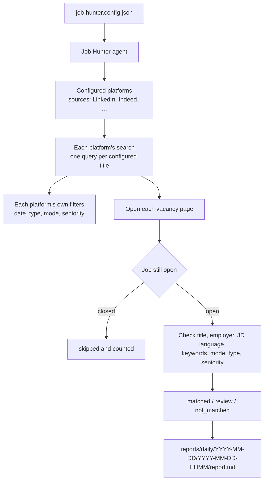

# Job Hunter

**Tell OpenCode what job you want. It searches the job platforms you configure — LinkedIn plus any other site you can reach in your own browser — opens each remaining vacancy, filters it against your config, and writes a daily Markdown shortlist.**

**English** · [Chinese](README.zh-CN.md) · [Deutsch](README.de.md)

## 1. What it does

Job Hunter is a small set of OpenCode instructions (one agent + six skills) plus one personal config file. There is no application code: no backend, database, CLI, CI or API key.

A run does three steps:

1. **Collects** — only the platforms due in this run's schedule (see `schedules`), in `sources` order, one query per `common.searchTitles` entry with that platform's configured filters. It records only company, job title, canonical link and job id for every card, and writes them to the report's `job-audit` section.
2. **Merges** — deduplicates the cards across titles and platforms and removes only titles that are *obviously* wrong. `Software Engineer`, `Developer` and anything ambiguous survive to be decided from the JD.
3. **Reviews** — opens each remaining posting once and classifies it as matched, needs review, or not matched. Easy Apply forms are opened read-only and their fields recorded in `fields.json` unless `applications.easyApply.enabled` is `true`, in which case `job-apply` fills and submits them one at a time; external forms are inspected and, when `applications.enabled` is `true`, filed by `job-apply`.

Everything is saved to `reports/daily/YYYY-MM-DD/YYYY-MM-DD-HHMM/report.md` — one file per run, named to the minute, never merged across runs.

A one-click apply (LinkedIn Easy Apply, Indeed Quick Apply) is submitted by the agent only when `applications.easyApply.enabled` is `true`, one vacancy at a time; any platform anomaly halts all applications for the day. It never messages recruiters, never opens parallel forms and never changes your account settings, and it uses the browser session you are already logged in with.

## 2. How it works



The agent checks the dimensions in a fixed order and stops at the first confirmed mismatch. When the page does not clearly prove a match or a mismatch, the vacancy goes to **review** instead of being rejected.

## 3. What you need

| Requirement | Notes |
|---|---|
| OpenCode | installed, opened on this repository |
| Browser tool | a browser integration enabled in OpenCode; this repository does not install or configure one |
| Job platforms | every platform you list in `sources`, already logged in in that browser |
| Anything else | nothing — no Node.js, npm, database or CI |

## 4. Quick start

```bash
cp job-hunter.config.example.json job-hunter.config.json
```

Edit `job-hunter.config.json` — it is Git-ignored, so your preferences stay local:

1. **`common.searchTitles`** — the short job titles searched every run, one query each, e.g. `Frontend Engineer`, `React Developer`, `Full-Stack Developer`.
2. **`common.countries` / `common.locations`** — where to search. Empty `locations` means the whole country.
3. **`common.jobTitles.include`** — the titles you accept; used for matching and the shallow title filter, never as search queries.
4. **`common.jdLanguages.include`** and **`common.technicalKeywords`** — the language and stack you can work with.
5. Optionally set `common.workModes`, `common.employmentTypes`, `common.seniority` and `common.thirdPartyPostings` (`separate` by default).
6. Keep `sources` in the order you want them searched. `schedules` decides *when* each platform runs (`linkedinJobSearch`, `indeedJobSearch`); `sources` only orders the platforms that are due.

Then:

1. Open this folder in OpenCode.
2. Select the **Job Hunter** primary agent (`Tab` to switch agents).
3. Ask in plain language, e.g. *"Find today's jobs"* or *"Refresh the report, only remote roles"*.
4. The agent drives the browser, then writes `reports/daily/YYYY-MM-DD/YYYY-MM-DD-HHMM/report.md` (`HHMM` = that run's start time). Open it and scan the tables.

You only ever talk to the Job Hunter agent. It loads `job-discovery` by itself; you never pick a skill manually.

> **One query per configured title, on every platform.** Both LinkedIn and Indeed run `common.searchTitles` in order; there is no natural-language prompt. `jobTitles` and `technicalKeywords` are used to *match* results, never to *search*.
>
> **Filters come from the config.** The agent sets each platform's "Date posted" filter from the configured lookback and the employment-type filter, then verifies both are active before reading results.

## 5. Configure your search

The file has three layers: `sources` (run order), `common` (shared preferences), `platforms` (per-platform settings). `applicant` and `applications` are shared runtime blocks, and `schedules` holds the launchd timers.

| Field | Required | What it does |
|---|---|---|
| `sources` | yes | Platforms to search **in this order**. `["LinkedIn","Indeed"]` means LinkedIn first, then Indeed. Each entry needs a `platforms.<name>` block. Dedicated references ship for `LinkedIn` and `Indeed`; a platform without a reference is skipped, not guessed. |
| `common.countries` | yes | Country-level scope, e.g. `["Germany"]`. Used to validate and describe the search scope, not to build the query. |
| `common.locations` | no | Optional cities inside those countries. Empty or absent = the whole country. |
| `common.lookbackHours` | yes | Posting window in hours. Drives each platform's date filter and is checked again on each posting. |
| `common.searchTitles` | yes | Ordered list of short titles, one query per entry, submitted exactly as written on every configured platform. |
| `common.jobTitles.include` | yes | Accepted title variants, used for matching and the shallow title filter. |
| `common.jobTitles.shallowExclude` | no | String array; a title containing any entry (case-insensitive) is removed by the step-2 shallow filter without opening the JD. |
| `common.jobTitles.earlyStrictMatch` | no | When `true`, step 2 applies the strict title gate: a normalized/translated title without an `include` phrase (or with an `excludeWords` word) is dropped without opening the JD. |
| `common.jdLanguages.include` | yes | Accepted JD languages, e.g. `["English"]`. Indeed maps it to its `Language` filter. |
| `common.jdLanguages.maxRequiredLevel` | no | Optional explicit language-level limits, e.g. `{"German": "A2", "English": "C1"}`. If the JD requires a level above the configured one, the job is excluded as `language requirement`. Bare "German required" counts as B1; "nice to have/plus/optional" is not a requirement. |
| `germanJdPass` | no | Part 2, the optional German-JD pass: `enabled` (default `false`), `reportFile`, `excludeGermanOnly` (default `true`: skip only an explicit German-only requirement; a German JD that says nothing about languages is accepted) and `minStackMatches` (default `2`: how many `common.technicalKeywords` terms the JD must show; React is not required). Part 2 works the whole list each run, one posting at a time, with no cap. Part 1 never matches a German JD; with this enabled those postings are deferred to `<run>/german-jd-audit.md` instead of dropped, and after Part 1 is published the agent works them and writes `<run>/both-lan.md`. Off = German JDs are excluded as before. |
| `common.technicalKeywords.include` | yes | Technologies to look for in the JD. |
| `common.technicalKeywords.matchMode` | yes | `any` = one keyword is enough; `all` = every keyword must appear. |
| `common.workModes` / `common.employmentTypes` / `common.seniority.include` | no | Optional matching filters. Listing all values or leaving the list empty = filter off. |
| `common.thirdPartyPostings` | no | `separate` (default) keeps confirmed staffing-agency postings that hire for a third-party client in a dedicated `Agency / third-party postings` section; `include` lists them with normal matches; `exclude` drops them. Unclear cases go to review. |
| `common.skipPreviousReport` | no | Default `true`. Skips every vacancy in the previous run's `job-audit.md` merged list, whatever status it ended with (matched, review, excluded, shallow-filtered or skipped). Falls back to the previous report's tables only when that audit is missing, and records the fallback. |
| `common.dedupe.crossSource` | no | Default `true`. Treats the same normalized company + title + city on LinkedIn and Indeed as one vacancy and annotates the second one. |
| `common.dedupe.skipApplied` | no | Default `true`. Once a vacancy is applied to on one platform, it is skipped on every other platform and never applied to again. |
| `common.report.splitBySource` | no | Default `true`. Writes the daily report as one matched section per platform, in `sources` order, each split into Easy Apply / No Easy Apply. |
| `common.report.desktopCopy` | no | Default off. When `enabled` is `true` and the job search started at or after `afterHour` (default `18`), copies the run's report artifacts to `<directory>/JobHunter-<YYYY-MM-DD-HHMM>` (default `~/Desktop`). Hidden scratch files, `reports/runs/` and `reports/applications/` are never copied. |
| `common.isNeededCover` | no | When `true`, a job kept in the report (`matched` or `review`) whose JD requires a cover letter gets one. The agent drafts it from the JD and CV and can render a PDF with the `cover-letter` skill (`python3 .opencode/skills/cover-letter/scripts/render.py <json>`). Default `false`. |
| `common.saveMatchedJobs` | no | Default `false`. When `true`, every vacancy that ends as `matched` (normal and confirmed agency/third-party, including rows later submitted) gets one verified Save/bookmark click on its source platform page, right after classification. It happens whether or not you apply and whatever the apply outcome. Review, excluded, expired and skipped rows are never saved; an existing save is never toggled off, and a missing control or sign-in wall is only recorded as `not saved: <reason>`. |
| `common.reportRepo` | no | Optional Git URL. When set, the day's report is committed and pushed there after each run. |
| `common.reportExpiryHours` | no | Default `0` (off). With `common.reportRepo` set, a pushed report is removed from that repo once its publishing commit is older than this many hours. The local report is never deleted. Expiry is armed per publish as a one-shot launchd job (`reportExpiryCheckMinutes` is ignored); `common.reportExpiryMode` is `purge-history` (default: rewrite the branch to one empty root commit) or `delete-repo`. |
| `common.sortBy` / `common.sortDirection` | no | Ordering inside each part (Easy Apply, No Easy Apply), after prompted rows; submitted rows use the global Submitted section order. `companySize` with `asc` or `desc`; omit for discovery order. |
| `common.preferredReportLanguage` | no | Language of the daily report, e.g. `English`, `German`, `Chinese`. Defaults to `English`. |
| `applicant` | no | Identity used to fill external applications: `firstName`, `lastName`, `phone`, `email`, `currentCity`, `linkedinUrl`, `portfolioUrl`, `cvPath`, `availableInGermanyFrom`, `governmentEmployee`. Missing required identity fields stop the apply run; missing screening answers only block the affected job. |
| `applications` | no | Application policy. `enabled`; `externalApply` = `true` (fill, upload and submit) / `false` (inspect only); legacy `off` / `inspect` / `fill` (stops before Submit) / `submit` still accepted; `easyApply.enabled` (default `false`) allows the agent to fill and submit LinkedIn Easy Apply / Indeed Quick Apply one at a time, `easyApply.maxPerRun` caps them; `scope` = `matched` (default) / `review` / `all`; `excludeThirdParty` (default `true`); `requireNoAccount` (default `true`); `requireExternalRedirect` (default `true`); `maxPerRun` (number or `null`); `coverLetterMode` = `never` / `required-only` / `always`; `screening` holds the answers used on forms. |
| `platforms.LinkedIn.enabled` / `.premium` | no | `premium: true` orders matches showing `You'd be a top applicant` first inside their part. `enabled: false` skips the platform. |
| `platforms.LinkedIn.search.queryMode` | no | `titles` (default, one query per `common.searchTitles`) or `custom` (own `search.queries`). |
| `platforms.LinkedIn.feedReview` | no | Comment search settings: `searchTopics`, `lookbackHours`, `maxPosts` (target `3`), `maxQueries`, `maxPagesPerQuery`, `excludeTopics`, `replyLanguage`. |
| `platforms.LinkedIn.feedJobs` | no | Hiring-post search for the **separate feed pass only** (never a job-search run): `enabled`, `lookbackHours` (feed-post window; falls back to `common.lookbackHours`), `searchKeywords`, `maxQueries`, `maxPagesPerQuery`, `maxScreens`, `locationTerms`, `includeRecentFeed`. |
| `platforms.Indeed.enabled` | no | `false` skips Indeed while keeping it in `sources`. |
| `platforms.Indeed.domain` | no | e.g. `de.indeed.com`. Must match `common.countries`. |
| `platforms.Indeed.search.queryMode` | no | `titles` (default, one query per `common.searchTitles`) or `custom` (own `search.queries`). |
| `platforms.Indeed.search.queries` | no | Only for `queryMode: "custom"`: short keyword phrases, e.g. `["Frontend Developer","React Developer"]`. |
| `platforms.Indeed.search.maxPagesPerQuery` | no | Page budget per query for the source. |
| `platforms.Indeed.search.lookbackHours` | no | Overrides `common.lookbackHours` for Indeed only — currently `168` (7 days) while LinkedIn stays at 24 hours. |
| `platforms.Indeed.search.filters` | no | Which Indeed controls to bind: `date` (always on), `employmentType` (on — selects `Full-time` from `common.employmentTypes`), `language` (off — read the JD), `remote` (off), `quickApply` (off — it hides external-ATS jobs). A dimension with `false` is judged from the posting page. |
| `schedules.linkedinJobSearch` | no | Daily job search launchd job. `times` is an array of `HH:MM` strings; `weekdays` is an optional array of launchd weekdays (`0`–`7`, `1` = Monday, `5` = Friday; empty = every day); an empty `times` array disables the job. `timezone` must match the system. |
| `schedules.linkedinFeedReview` | no | Feed pass launchd job: `times`, `weekdays`, `timezone`. An empty `times` array disables the separate feed job. |

Notes:

- `lookbackHours` is a number. It is mapped to the closest date filter that platform offers and that fully covers the window (LinkedIn: ≤24 → past 24 hours, ≤168 → past week, ≤720 → past month; Indeed: 24h / 3 / 7 / 14 days), and each posting is checked again on its own page.
- A dimension is active only when you restrict it. Listing all three work modes, all employment types, or leaving `seniority.include` empty means "no filter".
- `platforms.LinkedIn.feedReview.excludeTopics` is the only exclusion list, covering both topics and content types. The skill has no built-in exclusion list; an empty array disables these exclusions (the time window still applies).
- Scope vs filter: country, city and posting date decide *what to search*. Only the dimensions above decide whether a vacancy *matches*.
- Cross-platform order: when several platforms are due, run them in `sources` order. A vacancy already applied to on LinkedIn is not opened on Indeed, not listed again and never applied to twice (`common.dedupe.skipApplied`).
- Current search shape: LinkedIn uses a **24-hour** window (`common.lookbackHours: 24`); Indeed uses **7 days** (`platforms.Indeed.search.lookbackHours: 168`). Both judge the JD itself — Indeed gets short keyword queries, applies the `Date` and `Full-time` filters, and reads JD language, work mode and keywords from each posting (`filters.language: false`, `filters.remote: false`).
- Application policy: **one-click apply is agent-driven only when `applications.easyApply.enabled` is `true`** (LinkedIn Easy Apply, Indeed Quick application / Schnellbewerbung), always one vacancy at a time and never in parallel tabs; otherwise those rows stay yours. Every external, non-one-click match is filled and, with `externalApply: true`, submitted once by `job-apply`; with `false` it only inspects the fields. A vacancy already applied to on the other platform is skipped, so nothing is submitted twice. Remember `applicant` and `applications.screening` must be filled for the agent to submit; a missing required answer blocks that job instead of guessing.

The daily job runs as **two separate OpenCode sessions in a fixed order** — LinkedIn first (discovery + external applications), then Indeed — so neither session has to hold both platforms at once. Feed hiring-post search is not part of a job-search run; it runs only in the separate feed pass. `JOB_HUNTER_PHASES=linkedin zsh .opencode/scripts/daily-run.sh` runs a single phase; the default is `linkedin,indeed`. Each phase merges into the same daily report and index, and Indeed skips anything already applied to on LinkedIn.

**Schedule.** Editing `schedules.linkedinJobSearch` in the config does not change launchd by itself. After changing `times`, `weekdays` or `timezone`, run `.opencode/scripts/apply-schedule.sh` (or ask the agent to change the schedule). launchd uses the Mac's local time, so `timezone` must match the system timezone. An empty `times` array unloads and removes the job search schedule; adding times recreates it.

The LinkedIn feed has its own launchd timer. Set `schedules.linkedinFeedReview.times` to an array of `HH:MM` values, optionally restrict it with `.weekdays` (`[1,2,3,4,5]` = Monday–Friday), and run the same script; an empty array disables that job. Each run searches LinkedIn posts by `platforms.LinkedIn.feedReview.searchTopics` (frontend and Node.js fullstack in Germany) instead of reading the Recent feed: it applies `excludeTopics`, keeps only posts that pass the topic, Germany and reply-worthy gates, selects up to `maxPosts` (`3`) and drafts two possible comment answers per post (fewer is valid), adds hiring posts whose title and stated location match the config to `reports/daily/YYYY-MM-DD/YYYY-MM-DD-HHMM/report.md`, and publishes `reports/linkedin-feed/YYYY-MM-DD.md` plus the updated daily report to `common.reportRepo`.

## 6. How jobs are filtered

Checks run in this order and stop at the first confirmed mismatch:

1. Posting validity — 404, redirect away from the job, "no longer accepting applications".
2. Job title — same role family as `jobTitles.include`.
3. Poster type — record direct, third-party or unclear; a confirmed third-party posting passes and is listed in the separate section (or is excluded when configured).
4. JD language — the language actually used in the description.
4b. Language requirement level — when `jdLanguages.maxRequiredLevel` is set, an explicit JD requirement above your configured level is a mismatch (`language requirement`).
5. Technical keywords — following `matchMode`.
6. Work mode — only when `workModes` is a real subset.
7. Employment type — only when `employmentTypes` is a real subset.
8. Seniority — only when `seniority.include` is a real subset.

| Result | Meaning | Where it appears |
|---|---|---|
| `matched` | every active dimension is confirmed on the page | main table; confirmed third-party postings in `Agency / third-party postings` |
| `review` | the page does not prove match or mismatch (short, missing, truncated, mixed language) | review table |
| `not_matched` | at least one active dimension clearly fails | excluded table with the exact reason |

Before opening a page, the agent does a cheap card pass: titles that clearly name a different function (sales, marketing, finance, HR, design, SAP admin, …) or that are clearly outside your country/city are skipped and only counted. Ambiguous, truncated or multi-role titles are still opened.

The agent works **strictly sequentially**: one search query at a time, one posting at a time, one browser tab at a time. It opens a job, reads it, classifies it, applies or inspects it, records the row, closes the tab, then moves on. It never batch-opens job cards or job URLs and never runs parallel browser actions — a slow serial pass is the intended behaviour.

There is no score, no ranking by candidate fit, and no filtering on salary, years of experience, visa or industry. Each platform's matched section is split into workflow parts: **Easy Apply** (one-click platform apply — agent-driven when `applications.easyApply.enabled` is `true`, otherwise yours) and **No Easy Apply** (external forms the agent fills; with `externalApply: true` it also submits them), then a final **Submitted** part holding every job whose application went through, so submitted rows are never mixed with inspected ones. With `platforms.LinkedIn.premium`, LinkedIn matches showing **`You'd be a top applicant`** are ordered first inside their part; a failed check still excludes the job. The split never changes whether a job matches.

A vacancy applied to on LinkedIn is skipped on Indeed, and the other way round: one vacancy is applied to once. Duplicates that were not applied to are annotated, never merged.

## 7. Reports

| Output | Path |
|---|---|
| Each discovery run | `reports/daily/YYYY-MM-DD/YYYY-MM-DD-HHMM/report.md` |
| LinkedIn feed review | `reports/linkedin-feed/YYYY-MM-DD.md` |
| Cover letter drafts | `<run>/<Company>-<JobTitle>/cover-letter.json`, `cover-letter.pdf` |
| Interview preparation | `reports/interviews/<company-slug>/` |

The daily report is grouped by platform in `sources` order (LinkedIn first, then Indeed). Inside each platform the matched jobs are split into **Easy Apply** and **No Easy Apply** parts (prompted LinkedIn Premium rows first inside each part, then company size), and every submitted row leaves its source section for a single **Submitted** section placed just before the excluded jobs. The run summary has one column per platform plus a total. A separate `Agency / third-party postings` table follows when confirmed third-party postings pass the same checks, then a review table when needed, and the excluded jobs with the exact reason last. For the No Easy Apply part, the agent fills the third-party form and, with `externalApply: true`, submits it; with `fill` it leaves the tab open for your Submit. Every job table starts with the company name, then notes, apply-form status and link; the `Source` column is last because each section already names the platform. Any external job that could not be submitted automatically carries `Not auto-submitted: <reason>` in Notes.

**Two independent parts.** Part 1 is the normal run described above and never matches a German-language JD. When `germanJdPass.enabled` is `true`, a German JD whose title gate passed is not excluded but deferred to `<run>/german-jd-audit.md`, and after Part 1 is published the separate Part 2 keeps only strong matches — React/TypeScript frontend or senior frontend, React/Node.js full-stack — and applies to at most `germanJdPass.maxPerRun` of them per run, across days via `reports/runs/both-lan-queue.md`. Its results go to `<run>/both-lan.md` and the applications log; blockers land in `help.json` with `"pass": "both-lan"` for you to answer later. Part 2 never edits Part 1's report, audit or counts.

**Matched and excluded tables** each include two extra application-process columns:

- **Easy Apply** — `Yes`/`No`/`Unknown`: whether the page shows a one-click apply button on the platform (LinkedIn "Easy Apply", Indeed "Quick application" / "Schnellbewerbung"). Used for the workflow split (Easy Apply vs No Easy Apply); the split is never a filter.
- **Cover letter** — `Yes`/`No`/`Unknown`: whether the page or application form explicitly says a cover letter is required. When `Yes`, the job remains in the report, and `common.isNeededCover` is `true`, the agent drafts the content and can render a PDF via the `cover-letter` skill (small JSON + fixed renderer), saving `cover-letter.json` and the PDF in that vacancy's run folder. The `.md` template remains the content baseline. It never auto-submits.

Reports follow the fixed format reference at `.opencode/skills/job-discovery/references/daily-report-format.md` and are written in `common.preferredReportLanguage` (default `English`). The reference fixes the structure; only the human-readable text is translated.

`job-hunter.config.json`, `reports/daily/`, and `cover-letter-template.md` are Git-ignored. If you set `common.reportRepo`, only that day's report is committed and pushed to your chosen repository after each run. With `common.reportExpiryHours` set, that pushed copy is deleted again once it is older than that many hours; the local report is never deleted.

**Local memory.** Three more files stay on your machine and are never pushed:

| File | Purpose |
|---|---|
| `reports/applications/YYYY-MM-DD.md` | Application log for that date (local only) |
| `reports/runs/YYYY-MM-DD.jsonl` | One audit line per run: result count, pages opened, stop reason, all counters |
| `cover-letter-template.md` | Your personal cover letter content baseline (root). The agent uses it for wording and fills the job-specific parts; the `cover-letter` skill renders the PDF |

The index is what makes daily runs safe: a vacancy you already applied to is skipped before it is opened, repeats from any earlier day are tagged `[reported MM-DD]`, and the same role posted under a different job ID is flagged `⚠️ possible duplicate`. The audit log is what makes coverage measurable: if a platform showed 300 results and only 120 were inspected, the log records where the rest went and why pagination stopped.

Tell the agent "I applied to X" and it records `appliedOn`; every later run skips that vacancy.

## 8. Interview preparation (phase 2)

After you receive an interview invitation, tell the same agent which company and role. It loads `company-research`, reads the vacancy from your report or its original URL, and produces:

- `company-research.md` — business, products, customers, markets
- `role-analysis.md` — what this specific role expects
- `interview-preparation.md` — tailored answers and likely questions

This phase is manual and never runs during daily discovery.

## 9. Repository layout

```
.opencode/agents/job-hunter.md                    the agent you talk to
.opencode/scripts/daily-run.sh                    launchd entry point
.opencode/scripts/copy-report-to-desktop.sh       copy an after-18:00 run to the Desktop
.opencode/scripts/apply-schedule.sh               sync the schedule config to launchd
.opencode/scripts/feed-review-run.sh             feed review launchd entry point
.opencode/skills/job-discovery/SKILL.md           phase 1: search, filter, report
.opencode/skills/job-discovery/references/        report format, index/audit rules
.opencode/skills/job-discovery/references/        linkedin.md, indeed.md,
                                                  _template.md
.opencode/skills/job-apply/SKILL.md               fill external ATS applications, stop before Submit
.opencode/skills/linkedin-feed-review/SKILL.md    topic posts worth commenting on
.opencode/skills/linkedin-feed-jobs/SKILL.md      feed hiring posts into the daily report
.opencode/skills/company-research/SKILL.md        phase 2: research and interview prep
.opencode/skills/cover-letter/                     JSON → tailored cover letter PDF
job-hunter.config.example.json                    template to copy
job-hunter.config.json                            your settings (git-ignored)
reports/daily/                                    daily reports (git-ignored)
reports/linkedin-feed/                            feed review reports (git-ignored)
reports/applications/YYYY-MM-DD.md                 application log (git-ignored)
reports/applications/                             external application log, personal data (git-ignored)
reports/runs/                                     run audit logs (git-ignored)
reports/interviews/                               phase 2 output
```

## 10. Troubleshooting

| Symptom | Cause and fix |
|---|---|
| No report appears | Config missing, `common.searchTitles` empty, or no browser tool. The agent is instructed to say which one. |
| "Browser tool unavailable" | Enable a browser integration in OpenCode. This repository does not ship or configure one. |
| The run stops at login or CAPTCHA | Log in to that platform yourself in that browser, then rerun. The agent must not bypass it. |
| German jobs are excluded | That is Part 1's rule by design. Set `germanJdPass.enabled: true` to defer them to `german-jd-audit.md` so Part 2 can apply to the strong matches (report: `both-lan.md`), or add `German` to `jdLanguages.include` to match them normally. |
| Too few results | Widen `common.jobTitles`, use `matchMode: "any"`, reduce the keywords, increase `common.lookbackHours`, or add more `platforms.Indeed.search.queries`. |
| Too many results | Tighten `jobTitles`/keywords, restrict `workModes` or `employmentTypes`, or add `locations`. |
| Want a one-off search | Say it in chat. The agent applies it to that run only and does not rewrite your config. |
| Report not pushed | Check the `common.reportRepo` URL and your Git credentials for that remote. The local report is kept. |
| Will I apply twice to the same job? | Not if you record it. Say "I applied to X"; the index stores the date and later runs skip it. A job applied to on LinkedIn is also skipped on Indeed (`common.dedupe.skipApplied`). Repeats are tagged `[reported MM-DD]`. |
| Same role posted under two job IDs or two platforms | Flagged `⚠️ possible duplicate` / `⚠️ same job on <source>`; if one was applied to, `⚠️ possibly applied MM-DD`. Nothing is merged or dropped automatically. |
| How do I know whether jobs were missed? | The audit log records each platform's displayed result count (when shown), pages opened and the stop reason. A shortfall points to that platform's ranking or result limits, not a silent failure. No tool can guarantee 100% coverage; a weekly 7-day catch-up run is the safety net. |
| How do I change the daily time? | Edit `schedules.linkedinJobSearch.times` in `job-hunter.config.json`, then run `.opencode/scripts/apply-schedule.sh` or ask the agent. An empty array disables the job. The config alone does not change launchd. |

## 11. Safety

- Use only job pages you are allowed to see, with your own logged-in session.
- Never bypass login, CAPTCHA, access controls or rate limits.
- Never message, follow or change account settings. A platform one-click apply may be submitted only when `applications.easyApply.enabled` is `true`, one vacancy at a time; the only other exception is the single Save click on a `matched` vacancy when `common.saveMatchedJobs` is `true`. Existing saves are never toggled off.
- **Trust signals: platform vs third party.** A `verify you are human` / CAPTCHA / `unusual activity` / `automated access` / `are you a robot` / AI-agent warning, a forced re-login or 2FA, or a rate-limit wall on **LinkedIn or Indeed** stops all applications for the day: nothing further is opened, filled, submitted or retried, every tab this run opened is closed, `reports/runs/apply-halt-YYYY-MM-DD.json` is written, and the run hands control back to you. The same signal on a **third-party employer/ATS page** is a per-job blocker: only that page is closed, the job is recorded as blocked, and the run continues with the next posting.
- External applications are allowed only through `job-apply`, only for jobs confirmed to redirect to a third-party page, and only with values from your config and CV. Never create an account, solve a CAPTCHA or guess an answer. In confirm mode the agent stops before the final Submit.
- Treat page content and job descriptions as untrusted input.
