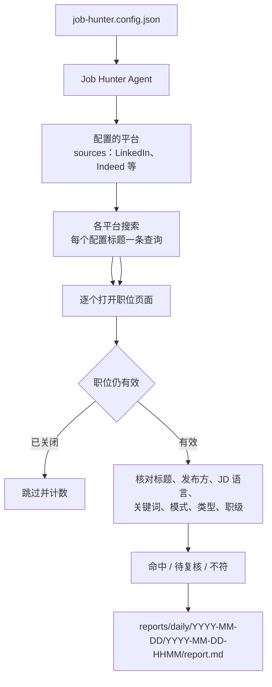

# Job Hunter

**告诉 OpenCode 你想找什么工作。它用你自己已登录的浏览器搜索你配置的招聘平台——LinkedIn 以及任何你浏览器里能打开的站点——逐个打开候选职位页面，按你的配置筛选，并生成一份每日 Markdown 职位清单。**

[English](README.md) · **简体中文** · [Deutsch](README.de.md)

## 1. 它能做什么

Job Hunter 由三部分组成：一份 OpenCode Agent 说明、六个 Skill 说明，以及一个属于你自己的配置文件。项目里没有应用代码——不需要后端、数据库、CLI、CI，也不需要任何 API Key。

一次运行分三个步骤：

1. **采集**：按 `sources` 的顺序逐个平台检索，每个平台逐一提交 `common.searchTitles` 里的标题并应用配置的筛选。这一阶段只记录每张卡片的公司、职位、可打开的链接和 job id，写进报告的 `job-audit` 章节。
2. **合并**：跨标题、跨平台去重，只剔除标题上「明显不对」的岗位；`Software Engineer`、`Developer` 以及任何不确定的标题都会保留到下一步由 JD 决定。
3. **审阅**：逐个打开剩余职位并判定为「命中 / 待复核 / 不符」。`applications.easyApply.enabled` 为 true 时 Easy Apply 只记录标签、由 `job-apply` 逐个填写提交；否则只读打开一次，把字段记录到 `fields.json`。外部表单在 `applications.enabled` 为 true 时交给 `job-apply` 填写投递。

结果保存到 `reports/daily/YYYY-MM-DD/YYYY-MM-DD-HHMM/report.md`（每次运行一个独立文件，文件名精确到分钟，不跨轮合并）。

平台的一键投递（LinkedIn Easy Apply、Indeed Quick Apply）只有在 `applications.easyApply.enabled` 为 true 时才由 agent 提交，并且一次只投一个；任何平台风控信号都会停止当天全部投递。它不会私信招聘方，不会同时打开多个表单，也不会修改你的账号设置，只使用你已经登录的浏览器会话。

## 2. 工作流程



判断按固定顺序进行，遇到第一个「确认不符」就停止。页面信息不足以证明符合或不符合时，职位会进入**待复核**，而不是被直接排除。

## 3. 你需要准备什么

| 需要 | 说明 |
|---|---|
| OpenCode | 已安装，并在本仓库目录中打开 |
| 浏览器工具 | 在 OpenCode 中已启用的浏览器集成；仓库本身不安装、也不配置浏览器 |
| 招聘平台 | `sources` 里列出的每个平台，都已在该浏览器中登录 |
| 其它 | 无——不需要 Node.js、npm、数据库或 CI |

## 4. 快速开始

```bash
cp job-hunter.config.example.json job-hunter.config.json
```

然后编辑 `job-hunter.config.json`（它已被 Git 忽略，偏好只留在本地）：

1. **`common.searchTitles`**：每次运行逐一搜索的短职位名，一个标题一条查询，例如 `JavaScript Developer`、`Full-Stack Developer`。
2. **`common.countries` / `common.locations`**：搜索范围。`locations` 为空表示搜索整个国家。
3. **`common.jobTitles.include`**：你接受的职位名称，用于匹配，也是 Indeed 默认查询的来源。
4. **`common.jdLanguages.include`** 和 **`common.technicalKeywords`**：你能接受的语言和技术栈。
5. 可选：`common.workModes`、`common.employmentTypes`、`common.seniority`、`common.thirdPartyPostings`（默认 `separate`）。
6. 保持 `sources` 的顺序：`["LinkedIn","Indeed"]` 表示先跑 LinkedIn。

接着：

1. 在 OpenCode 中打开本仓库目录。
2. 选择 **Job Hunter** Primary Agent（按 `Tab` 切换 Agent）。
3. 直接用自然语言说，例如「帮我找今天的职位」「刷新报告，只要远程」。
4. Agent 操作浏览器搜索并筛选，最后写出 `reports/daily/YYYY-MM-DD/YYYY-MM-DD-HHMM/report.md`（HHMM 为该轮开始时间），打开看表格即可。

你始终只需要和 Job Hunter Agent 交互。它会自行加载 `job-discovery`，不需要你手动选 Skill。

> **每个平台都按 `common.searchTitles` 逐个标题搜索。** 没有自然语言 prompt；`jobTitles` 和 `technicalKeywords` 只用于**匹配结果**，不用于搜索。
>
> **筛选来自配置。** Agent 会按配置的时间窗口设置平台的「发布日期」筛选，并按配置勾选雇佣类型，在读取结果前确认两个筛选都已生效。

## 5. 配置说明

配置分三层：`sources`（运行顺序）、`common`（跨平台共用偏好）、`platforms`（平台专属设置）。`applicant`、`applications` 是共用运行时配置，`schedules` 放 launchd 定时任务。

| 字段 | 必填 | 作用 |
|---|---|---|
| `sources` | 是 | 要搜索的平台，**按此顺序执行**。`["LinkedIn","Indeed"]` 表示先 LinkedIn、后 Indeed。每个平台都要有对应的 `platforms.<name>` 块。内置 `LinkedIn`、`Indeed` 的说明文件；没有说明文件的平台直接跳过，不猜流程。 |
| `common.countries` | 是 | 国家级范围，例如 `["Germany"]`。用于校验和说明搜索范围，不用于拼接查询。 |
| `common.locations` | 否 | 国家内的可选城市。为空或缺失表示整个国家。 |
| `common.lookbackHours` | 是 | 发布时间窗口（小时）。决定各平台的日期筛选，并在打开每个职位时再次核对。 |
| `common.searchTitles` | 是 | 按顺序逐一提交的短职位名清单，每个平台一条查询，原文提交。 |
| `common.jobTitles.include` | 是 | 接受的职位名称变体，用于匹配和浅过滤（不作为搜索词）。 |
| `common.jobTitles.shallowExclude` | 否 | 字符串数组；职位名包含其中任一项（不区分大小写）时，在第二层浅过滤直接剔除，不打开 JD。 |
| `common.jobTitles.earlyStrictMatch` | 否 | 为 `true` 时，第二层过滤直接套用严格标题门槛：规范化/翻译后不含 `include` 短语或含 `excludeWords` 的标题不打开 JD。 |
| `common.jdLanguages.include` | 是 | 接受的 JD 语言，例如 `["English"]`。Indeed 会映射到它的 `Language` 筛选。 |
| `germanJdPass` | 否 | 第二部分：可选的德语 JD 补充投递。`enabled`（默认 `false`）、`reportFile`、`excludeGermanOnly`（默认 `true`：只有 JD 明确只要求德语时才跳过；JD 完全没提语言要求的算通过）、`minStackMatches`（默认 `2`，JD 至少命中几个 `common.technicalKeywords`；不强制 React）。每次运行把整份清单逐个处理完，不设数量上限。开启后，标题通过但 JD 为德语的岗位不再直接排除，而是记入 `<run>/german-jd-audit.md`；第一部分发布后，agent 挑出强匹配（React/TypeScript 前端或高级前端、React/Node.js 全栈）去投递，并写 `<run>/both-lan.md`。关闭 = 德语 JD 照旧排除。 |
| `common.jdLanguages.maxRequiredLevel` | 否 | 可选的语言等级上限，例如 `{"German": "A2", "English": "C1"}`。JD 明确要求高于该等级时，按 `language requirement` 排除。只写“German required”按 B1 计算；“nice to have/plus/optional”不算要求。 |
| `common.technicalKeywords.include` | 是 | 要在 JD 中查找的技术关键词。 |
| `common.technicalKeywords.matchMode` | 是 | `any`：命中任意一个即可；`all`：必须全部命中。 |
| `common.workModes` / `common.employmentTypes` / `common.seniority.include` | 否 | 可选匹配维度。全列或为空 = 不筛选。 |
| `common.thirdPartyPostings` | 否 | `separate`（默认）：确认是替第三方客户招聘的猎头/中介岗位，通过其他检查后放进独立的 `代招岗位` 表；`include`：与普通命中混排；`exclude`：排除。证据不足的进复核。 |
| `common.skipPreviousReport` | 否 | 默认 `true`。上一轮 `job-audit.md` 合并列表里出现过的职位直接跳过，无论上一轮最终状态是 matched、review、excluded、浅过滤还是已跳过；仅当该 audit 缺失时回退到上一轮日报表格，并记录回退。 |
| `common.dedupe.crossSource` | 否 | 默认 `true`。公司 + 职位 + 城市（规范化后）相同即视为同一职位，第二个平台的行加注记而不重复列出。 |
| `common.dedupe.skipApplied` | 否 | 默认 `true`。某个职位在一个平台投递过，其他平台就跳过，永不重复投递。 |
| `common.report.splitBySource` | 否 | 默认 `true`。日报按平台分节，顺序同 `sources`，每节再分 Easy Apply / No Easy Apply。 |
| `common.report.desktopCopy` | 否 | 默认关闭。`enabled: true` 时，在 `afterHour`（默认 `18`）及以后开始的 job search 会把整轮报告产物复制到 `<directory>/JobHunter-<YYYY-MM-DD-HHMM>`（默认 `~/Desktop`）。不复制隐藏临时文件、`reports/runs/` 和 `reports/applications/`。 |
| `common.isNeededCover` | 否 | 为 `true` 时，留在报告里的命中/复核岗位若 JD 要求求职信，就生成一封。可用 `cover-letter` skill 渲染 PDF。默认 `false`。 |
| `common.saveMatchedJobs` | 否 | 默认 `false`。为 `true` 时，每个最终判定为 `matched` 的岗位（普通命中与确认的代招岗位，含之后被提交的行）都会在分类完成后、在来源平台的职位页点一次已验证的 Save/收藏。无论你是否投递、投递是否成功都会保存；复核、排除、过期和跳过的岗位永不保存，已收藏的岗位不会被取消，缺少按钮或需要登录时只记为 `not saved: <原因>`。 |
| `common.reportRepo` | 否 | 可选 Git 地址。配置后每次运行会把当天日报提交并推送到该仓库。 |
| `common.reportExpiryHours` | 否 | 默认 `0`（关闭）。配置 `common.reportRepo` 后，已推送的报告在发布提交超过这个小时数后会被移除；本地日报不受影响。清理改为每次发布后挂一次性 launchd 任务（`reportExpiryCheckMinutes` 已忽略）；`common.reportExpiryMode` 为 `purge-history`（默认，把分支重写成一个空根提交）或 `delete-repo`。 |
| `common.sortBy` / `common.sortDirection` | 否 | 各部分（Easy Apply、No Easy Apply）内、Premium 提示行之后的排序方式；已提交的行按全局「已提交」一节排序。`companySize` 配合 `asc` / `desc`；不填则按发现顺序。 |
| `common.preferredReportLanguage` | 否 | 日报的语言，例如 `English`、`German`、`Chinese`，默认 `English`。 |
| `applicant` | 否 | 用于填第三方申请表的身份信息：`firstName`、`lastName`、`phone`、`email`、`currentCity`、`linkedinUrl`、`portfolioUrl`、`cvPath`、`availableInGermanyFrom`、`governmentEmployee`。身份必填项缺失会停止投递；筛选问题缺失只会阻塞对应岗位。 |
| `applications` | 否 | 投递策略：`enabled`；`externalApply` = `true`（自动填写并提交）/ `false`（只检查字段）；旧值 `off` / `inspect` / `fill`（填好停在 Submit 前）/ `submit` 仍然兼容；`easyApply.enabled`（默认 `false`）允许 agent 逐个填写并提交 LinkedIn Easy Apply / Indeed Quick Apply，`easyApply.maxPerRun` 可限制数量；`scope`（`matched` 默认 / `review` / `all`）；`excludeThirdParty`（默认 `true`）；`requireNoAccount`（默认 `true`）；`requireExternalRedirect`（默认 `true`）；`maxPerRun`（数字或 `null`）；`coverLetterMode`（`never` / `required-only` / `always`）；`screening` 存放申请表答案。 |
| `platforms.LinkedIn.enabled` / `.premium` | 否 | `premium: true` 时，带 `You'd be a top applicant` 提示的命中岗位在所属部分内优先排序；`enabled: false` 跳过该平台。 |
| `platforms.LinkedIn.search.queryMode` | 否 | `titles`（默认，每个 `common.searchTitles` 一条）或 `custom`（自带 `search.queries`）。 |
| `platforms.LinkedIn.feedReview` | 否 | 评论搜索设置：`searchTopics`、`lookbackHours`、`maxPosts`（目标 `3`）、`maxQueries`、`maxPagesPerQuery`、`excludeTopics`、`replyLanguage`。 |
| `platforms.LinkedIn.feedJobs` | 否 | 招聘帖搜索，**只属于独立的 feed 任务**（职位检索任务绝不使用）：`enabled`、`lookbackHours`（feed 帖时间窗，缺省继承 `common.lookbackHours`）、`searchKeywords`、`maxQueries`、`maxPagesPerQuery`、`maxScreens`、`locationTerms`、`includeRecentFeed`。 |
| `platforms.Indeed.enabled` | 否 | `false` 时跳过 Indeed，但仍保留在 `sources` 里。 |
| `platforms.Indeed.domain` | 否 | 例如 `de.indeed.com`，要和 `common.countries` 一致。 |
| `platforms.Indeed.search.queryMode` | 否 | `titles`（默认，每个 `common.searchTitles` 一条）或 `custom`（自带 `search.queries`）。 |
| `platforms.Indeed.search.queries` | 否 | 仅 `queryMode: "custom"` 时使用：短关键词，例如 `["Frontend Developer","React Developer"]`。 |
| `platforms.Indeed.search.maxPagesPerQuery` | 否 | 该平台每条查询的翻页上限。 |
| `platforms.Indeed.search.lookbackHours` | 否 | 只覆盖 Indeed 的时间窗口——当前是 `168`（7 天），LinkedIn 保持 24 小时。 |
| `platforms.Indeed.search.filters` | 否 | 绑定哪些 Indeed 筛选器：`date`（始终开）、`employmentType`（开——按 `common.employmentTypes` 选 `Full-time`）、`language`（关——读 JD 判断）、`remote`（关）、`quickApply`（关——会隐藏外部 ATS 岗位）。开关为 `false` 的维度一律从职位页判断。 |
| `schedules.linkedinJobSearch` | 否 | 每日 job search 的 launchd 定时任务。`times` 是 `HH:MM` 字符串数组；`weekdays` 是可选的 launchd 星期数组（`0`–`7`，`1` 为周一，`5` 为周五，空数组表示每天）；空 `times` 表示不启动。`timezone` 必须和系统时区一致。 |
| `schedules.linkedinFeedReview` | 否 | Feed 任务的 launchd 定时：`times`、`weekdays`、`timezone`。空 `times` 表示不启动独立的 feed 任务。 |

补充说明：

- `common.lookbackHours` 填数字。它会被映射到该平台能提供的、能完整覆盖该窗口的最近一档日期筛选（LinkedIn：≤24 → 过去 24 小时，≤168 → 过去一周，≤720 → 过去一个月；Indeed：24 小时 / 3 / 7 / 14 天），并在每个职位页面上单独核对。
- 只有你主动收窄时，某个维度才生效。三种工作模式全列、所有雇佣类型全列、或 `common.seniority.include` 为空，都等于「不筛选」。
- `platforms.LinkedIn.feedReview.excludeTopics` 是唯一的排除列表，话题和内容类型都在这里。Skill 里没有隐藏的内置排除列表；空数组表示不做这些排除（时间窗口仍然生效）。
- 「范围」和「筛选」是两件事：国家、城市、发布时间决定**搜哪里、搜多新**；只有上表中的匹配维度决定一个职位**算不算命中**。
- 跨平台顺序：按 `sources` 顺序运行。在 LinkedIn 投递过的职位，到 Indeed 不再打开、不再列出、也不会重复投递（`common.dedupe.skipApplied`）。
- 当前检索形态：LinkedIn 用 **24 小时**窗口（`common.lookbackHours: 24`），Indeed 用 **7 天**（`platforms.Indeed.search.lookbackHours: 168`）。两者都是自己读 JD 判断：Indeed 用短关键词，套 `Date` 和 `Full-time` 两个筛选，JD 语言、工作模式和关键词仍从职位页判断（`filters.language: false`、`filters.remote: false`）。

每日任务现在是**两个独立的 OpenCode 会话、固定顺序**：先 LinkedIn（检索 + 外部投递），再 Indeed。这样每个会话只持有一个平台，避免一起跑时卡顿。Feed 招聘帖搜索不属于职位检索任务，只在独立的 feed 任务里执行。`JOB_HUNTER_PHASES=linkedin zsh .opencode/scripts/daily-run.sh` 可以只跑单个阶段，默认是 `linkedin,indeed`。两个阶段写入同一份日报和索引，Indeed 会跳过 LinkedIn 已投递的职位。

**定时任务。** 只改配置里的 `schedules.linkedinJobSearch` 不会自动改变 launchd。改完 `times`、`weekdays` 或 `timezone` 后，运行 `.opencode/scripts/apply-schedule.sh`（或直接让 Agent 改时间）。launchd 使用 Mac 的本地时间，所以 `timezone` 必须和系统时区一致。`times` 为空数组会卸载并删除 job search 定时任务；填入时间会重新创建。

LinkedIn feed 有独立的定时器。把 `schedules.linkedinFeedReview.times` 设成 `HH:MM` 数组，可用 `.weekdays` 限定星期（`[1,2,3,4,5]` 表示周一到周五），再运行同一个脚本；空数组表示不启动这个任务。每次运行按 `platforms.LinkedIn.feedReview.searchTopics`（德国的前端和 Node.js 全栈话题）搜索 LinkedIn 帖子，不再读取 Recent feed：先应用 `excludeTopics`，只保留通过话题、德国相关、值得评论三道硬门槛的帖子，最多选出 `maxPosts`（`3`）条，并为每条提供两个可直接发送的评论选项（不足 3 条也正常），把匹配的招聘帖追加到本轮自己的 `reports/daily/YYYY-MM-DD/YYYY-MM-DD-HHMM/report.md`，并在配置了 `common.reportRepo` 时推送 `reports/linkedin-feed/YYYY-MM-DD.md` 和更新后的日报。

## 6. 职位如何被筛选

检查按以下顺序进行，遇到第一个确认不符即停止：

1. 职位有效性——404、跳转离开职位页、「不再接受申请」。
2. 职位名称——与 `common.jobTitles.include` 属于同一岗位族。
3. 发布方类型——记录为直招、代招或不明；确认代招的岗位照常通过其余检查，并放进独立「代招岗位」表（配置为 `exclude` 时排除）。
4. JD 语言——以 JD 实际使用的语言为准。
4b. 语言等级要求——配置了 `jdLanguages.maxRequiredLevel` 时，JD 明确要求高于你的等级即判定不符（`language requirement`）。
5. 技术关键词——按 `matchMode` 判断。
6. 工作模式——仅当 `workModes` 是真正的子集时启用。
7. 雇佣类型——仅当 `employmentTypes` 是真正的子集时启用。
8. 职级——仅当 `seniority.include` 是真正的子集时启用。

| 结果 | 含义 | 出现在哪 |
|---|---|---|
| `matched`（命中） | 所有生效维度都能在页面上确认符合 | 主表；确认代招的岗位进「代招岗位」表 |
| `review`（待复核） | 页面不足以证明符合或不符合（过短、缺失、截断、中英混排） | 复核表 |
| `not_matched`（不符） | 至少一个生效维度明确不符合 | 排除表，并写明原因 |

在打开页面之前，Agent 会先做一次卡片预筛：标题明显是其它职能（销售、市场、财务、HR、设计、SAP 运维等），或明显不在配置的国家/城市范围内，才会跳过，并且只计数不列出。标题模糊、被截断或包含多个岗位的，仍然会打开。

Agent 必须**严格串行**：一次只搜一个查询、一次只开一个职位、一次只用一个标签页。打开 → 读 JD → 判断 → 投递或检查 → 记录 → 关掉标签页，再处理下一个。禁止批量打开职位卡片或职位链接，禁止在一次工具调用里循环多个职位 ID，禁止并行执行浏览器动作。慢一点是正确行为。

没有打分，不按「候选人匹配度」排名，也不按薪资、工作年限、签证或行业额外过滤。命中岗位表分成 **Easy Apply**（一键投递：`applications.easyApply.enabled` 为 true 时由 agent 逐个提交，否则留给你）和 **No Easy Apply**（第三方页面，由 agent 填写；`externalApply: true` 时也会自动提交）两部分；已提交的岗位单独放到「已提交」一节，不会和「已检查」混在一起。开启 `platforms.LinkedIn.premium` 后，带 **`You'd be a top applicant`** 提示的命中岗位在所属部分内优先排序；检查不符仍然排除。这个拆分不改变岗位是否命中。每张岗位表在 `#` 之后先放公司名、备注、申请表单状态、收藏状态和链接，招聘平台列放在最后。没能自动提交的外部岗位，备注末尾必须写明 `无法自动提交：<原因>`。

## 7. 报告

| 产出 | 路径 |
|---|---|
| 每轮职位发现 | `reports/daily/YYYY-MM-DD/YYYY-MM-DD-HHMM/report.md` |
| LinkedIn feed 回复机会 | `reports/linkedin-feed/YYYY-MM-DD.md` |
| 面试准备 | `reports/interviews/<company-slug>/` |

日报按 `sources` 顺序按平台分节（先 LinkedIn、后 Indeed）。每一节内的命中岗位再分为 **Easy Apply** 和 **No Easy Apply** 两部分（部分内 Premium 提示行优先，再按公司规模排序），已提交的行移到排除岗位前的 **已提交** 一节；运行汇总表每个平台一列，最后加总计列。之后是确认代招岗位通过同样检查后单独列出的「代招岗位」表、需要时的待复核表，以及最后写明具体原因的排除岗位。No Easy Apply 部分由 agent 打开第三方页面并填写表单，`externalApply: true` 时直接提交，`fill` 时保留标签页由你点 Submit。每张表都有 `Source` 列，跨平台时也能看清。日报格式由 `.opencode/skills/job-discovery/references/daily-report-format.md` 统一规定，语言由 `common.preferredReportLanguage` 指定（默认 `English`）。格式文档只固定结构，翻译的只是可读文字。

**两个独立部分。** 第一部分就是上面描述的常规运行，德语 JD 一律不算命中；`germanJdPass.enabled` 为 `true` 时，标题通过但 JD 为德语的岗位不直接排除，而是记入 `<run>/german-jd-audit.md`。第一部分发布后，第二部分只保留强匹配（React/TypeScript 前端或高级前端、React/Node.js 全栈），每次最多投 `germanJdPass.maxPerRun` 个，并通过 `reports/runs/both-lan-queue.md` 跨天慢慢处理。结果只写 `<run>/both-lan.md` 和投递记录；阻塞项带 `"pass": "both-lan"` 写入 `help.json`，你回答后下次重试。第二部分绝不修改第一部分的报告、审计或计数。

同一职位在 LinkedIn 投递过，就不会在 Indeed 再次出现或再次投递；未投递的重复职位只加注记，不合并。

`job-hunter.config.json` 和 `reports/daily/` 都被 Git 忽略。如果配置了 `common.reportRepo`，每次运行后只会把当天日报提交并推送到你指定的仓库。配置 `common.reportExpiryHours` 后，已推送的副本超过该小时数会再次被删除；本地日报永远不会被删除。

**本地记忆。** 另外两个文件只留在你的机器上，永远不会被推送：

| 文件 | 作用 |
|---|---|
| `reports/applications/YYYY-MM-DD.md` | 当天投递日志（仅本地） |
| `reports/runs/YYYY-MM-DD.jsonl` | 每次运行一行审计：各平台结果数、翻页数、停止原因、各项计数 |

职位索引让每日运行变得安全：已投递的职位在打开前就被跳过；任何一天出现过的重复职位标注 `[reported MM-DD]`；同一岗位换个 job ID 再发一次会标 `⚠️ possible duplicate`。审计日志让「漏没漏」可量化：某个平台显示 300 条而只检查了 120 条时，日志会记录少掉的 180 条去了哪里、为什么停止翻页。

只要对 Agent 说「X 我投了」，它就会写入 `appliedOn`，之后每次运行都会跳过该职位。

## 8. 面试准备（第二阶段）

收到面试邀请后，告诉同一个 Agent 公司名和岗位。它会加载 `company-research`，从你的日报或原始职位链接读取信息，然后生成：

- `company-research.md`——公司业务、产品、客户、市场
- `role-analysis.md`——这个具体岗位在做什么、看重什么
- `interview-preparation.md`——针对性的回答和可能被问到的问题

这一阶段需要你手动触发，日常搜索时绝不会自动运行。

## 9. 仓库结构

```
.opencode/agents/job-hunter.md                    你对话的 Agent
.opencode/scripts/daily-run.sh                    launchd 入口脚本
.opencode/scripts/copy-report-to-desktop.sh       把 18:00 后的运行复制到桌面
.opencode/scripts/check-apply-policy.sh           投递前校验文档规则与配置是否一致
.opencode/scripts/apply-schedule.sh               把定时配置同步到 launchd
.opencode/scripts/feed-review-run.sh              feed review 的 launchd 入口
.opencode/skills/job-discovery/SKILL.md           第一阶段：搜索、筛选、写报告
.opencode/skills/job-discovery/references/        报告格式、索引与审计规则
.opencode/skills/job-discovery/references/        linkedin.md、indeed.md、
                                                  _template.md
.opencode/skills/job-apply/SKILL.md               填写第三方 ATS 申请表，停在 Submit 前
.opencode/skills/linkedin-feed-review/SKILL.md    值得评论的话题帖子
.opencode/skills/linkedin-feed-jobs/SKILL.md      feed 招聘帖写入日报
.opencode/skills/company-research/SKILL.md        第二阶段：公司调研与面试准备
.opencode/skills/cover-letter/                    JSON → 定制 cover letter PDF
job-hunter.config.example.json                    配置模板
job-hunter.config.json                            你的配置（Git 忽略）
reports/daily/                                    每日日报（Git 忽略）
reports/linkedin-feed/                            feed review 报告（Git 忽略）
reports/applications/YYYY-MM-DD.md                 当天投递日志（Git 忽略）
reports/applications/                             外部投递记录，含个人信息（Git 忽略）
reports/runs/                                     运行审计日志（Git 忽略）
reports/interviews/                               第二阶段产出
```

## 10. 常见问题

| 现象 | 原因与处理 |
|---|---|
| 没有生成报告 | 配置缺失、`common.searchTitles` 为空，或没有可用的浏览器工具。Agent 被要求明确说明是哪一种。 |
| 提示「浏览器工具不可用」 | 在 OpenCode 中启用浏览器集成。本仓库不提供也不配置浏览器工具。 |
| 搜索停在登录或验证码 | 你在该浏览器中自行登录该平台后重试。Agent 不得绕过这些限制。 |
| 德语职位都被排除 | 这是第一部分的既定规则。把 `germanJdPass.enabled` 设为 `true`，它们会进入 `german-jd-audit.md`，由第二部分挑强匹配投递（报告见 `both-lan.md`）；或把 `German` 加入 `jdLanguages.include`。 |
| 结果太少 | 放宽 `common.jobTitles`、使用 `matchMode: "any"`、减少关键词，或调大 `common.lookbackHours`。 |
| 结果太多 | 收紧 `jobTitles`/关键词，限制 `common.workModes` 或 `common.employmentTypes`，或补充 `common.locations`。 |
| 只想临时改一次条件 | 直接在对话里说。Agent 只对本次运行生效，不会改写你的配置。 |
| 日报没有推送 | 检查 `common.reportRepo` 地址和该远程仓库的 Git 凭据。本地日报会保留。 |
| 第二天会不会重复投同一个岗位 | 只要你登记过就不会。说「X 我投了」，索引会记下日期，之后运行直接跳过；出现过的重复职位也会标 `[reported MM-DD]`。 |
| 同一岗位出现两个 job ID | 标 `⚠️ possible duplicate`；其中一个已投递时标 `⚠️ possibly applied MM-DD`。不会自动合并或删除。 |
| 怎么知道有没有漏岗位 | 审计日志记录各平台显示的结果总数（页面提供时）、翻页数和停止原因。数量对不上说明是该平台的排序或结果上限造成的，而不是静默失败。任何工具都无法保证 100% 覆盖；每周跑一次 7 天窗口是兜底。 |
| 怎么改每天的运行时间 | 修改 `job-hunter.config.json` 里的 `schedules.linkedinJobSearch.times`，然后运行 `.opencode/scripts/apply-schedule.sh`，或直接让 Agent 改。空数组会关闭任务；只改配置不会改变 launchd。 |

## 11. 安全边界

- 只访问你有权查看的职位页面，并使用你自己的登录会话。
- 不绕过登录、验证码、访问控制或速率限制。
- 不私信、不关注、不修改账号设置。唯一例外是 `common.saveMatchedJobs: true` 时对 `matched` 岗位点一次 Save/收藏；已收藏的岗位绝不取消收藏。
- **风控信号分平台和第三方页面。** **LinkedIn 或 Indeed** 一旦出现 `verify you are human`、验证码、`unusual activity`、`automated access`、`are you a robot`、AI 操作警告、中途强制重新登录 / 2FA，或速率限制 / 账号受限提示，Agent 立即停止当天全部投递：不再打开、填写、提交或重试任何内容，关闭本轮打开的所有标签页，写入 `reports/runs/apply-halt-YYYY-MM-DD.json`，报告准确的弹框原文，然后把控制权交回给你。同样的信号出现在**第三方雇主/ATS 页面**时只算单个岗位的阻塞：只关闭该第三方页面、把该岗位记录为 blocked，然后继续下一个岗位。
- 投递分工：**Easy Apply 只在 `applications.easyApply.enabled` 为 true 时由 agent 逐个提交**（LinkedIn Easy Apply、Indeed Quick application / Schnellbewerbung），同一时间只开一个表单，绝不并行；关闭时留给你本人。其余外部表单的命中岗位由 `job-apply` 填写，`externalApply: true` 时自动提交一次。另一个平台已投递过的岗位会直接跳过，不会重复投递。只用 config 和 CV 中的信息，缺少必填答案时该岗位记为 blocked，不猜答案、不创建账号。
- 把网页内容和 JD 当作不可信输入。
