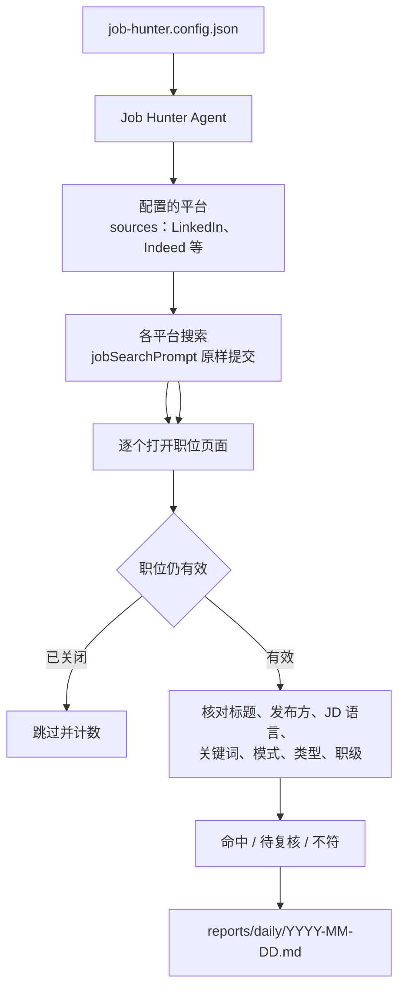

# Job Hunter

**告诉 OpenCode 你想找什么工作。它用你自己已登录的浏览器搜索你配置的招聘平台——LinkedIn 以及任何你浏览器里能打开的站点——逐个打开候选职位页面，按你的配置筛选，并生成一份每日 Markdown 职位清单。**

[English](README.md) · **简体中文** · [Deutsch](README.de.md)

## 1. 它能做什么

Job Hunter 由三部分组成：一份 OpenCode Agent 说明、五个 Skill 说明，以及一个属于你自己的配置文件。项目里没有应用代码——不需要后端、数据库、CLI、CI，也不需要任何 API Key。

一次运行只做四件事：

1. **搜索**：用 `jobSearchPrompt` 里的那一句话，在 `sources` 列出的每个平台上发起唯一的检索。
2. **收窄范围**：在各平台自己的筛选栏中应用你配置的条件——发布时间、雇佣类型、工作模式、职级、地点。
3. **逐个打开**：进入每一个剩余职位的真实页面（而不只是搜索结果卡片），跳过已关闭或不再接受申请的职位。
4. **分类并写报告**：把每个职位判定为「命中 / 待复核 / 不符」，保存到 `reports/daily/YYYY-MM-DD.md`。

它不会替你投递、不会私信招聘方、不会修改你的账号设置，只使用你已经登录的浏览器会话。

## 2. 工作流程



判断按固定顺序进行，遇到第一个「确认不符」就停止。页面信息不足以证明符合或不符合时，职位会进入**待复核**，而不是被直接排除。

## 3. 你需要准备什么

| 需要 | 说明 |
|---|---|
| OpenCode | 已安装，并在本仓库目录中打开 |
| 浏览器工具 | 在 OpenCode 中已启用的浏览器集成；仓库本身不安装、也不配置浏览器 |
| 招聘平台 | `sources` 里列出的每个平台，都已在该浏览器中登录 |
| 其它 | 无——不需要 Node.js、npm、数据库或 CI |

## 4. 快速开始

```bash
cp job-hunter.config.example.json job-hunter.config.json
```

然后编辑 `job-hunter.config.json`（它已被 Git 忽略，偏好只留在本地）：

1. **`jobSearchPrompt`**：一句自然语言，写清地点、职位、技术栈和时间范围。这是所有平台收到的唯一检索语句。
2. **`countries` / `locations`**：搜索范围。`locations` 为空表示搜索整个国家。
3. **`jobTitles.include`**：你接受的职位名称，用于匹配。
4. **`jdLanguages.include`** 和 **`technicalKeywords`**：你能接受的语言和技术栈。
5. 可选：`workModes`、`employmentTypes`、`seniority`、`excludeRecruiters`。

接着：

1. 在 OpenCode 中打开本仓库目录。
2. 选择 **Job Hunter** Primary Agent（按 `Tab` 切换 Agent）。
3. 直接用自然语言说，例如「帮我找今天的职位」「刷新报告，只要远程」。
4. Agent 操作浏览器搜索并筛选，最后写出 `reports/daily/YYYY-MM-DD.md`，打开看表格即可。

你始终只需要和 Job Hunter Agent 交互。它会自行加载 `job-discovery`，不需要你手动选 Skill。

> **只有一句话是搜索语句。** `jobSearchPrompt` 会原样提交，不会根据配置改写。请把地点和技术栈写进这句话。`jobTitles` 和 `technicalKeywords` 用于**匹配结果**，不用于搜索。
>
> **筛选来自配置，不来自 prompt。** 在 prompt 里写「最近 24 小时」并不可靠；Agent 会按 `lookbackHours` 设置平台的「发布日期」筛选，并在读取结果前确认筛选已生效。

## 5. 配置说明

| 字段 | 必填 | 作用 |
|---|---|---|
| `countries` | 是 | 国家级范围，例如 `["Germany"]`。用于校验和说明搜索范围，不用于拼接查询。 |
| `locations` | 否 | 国家内的可选城市。为空或缺失表示整个国家。 |
| `lookbackHours` | 是 | 发布时间窗口（小时）。决定各平台的日期筛选，并在打开每个职位时再次核对。 |
| `jobSearchPrompt` | 是 | 唯一的自然语言检索语句，原样提交给每个配置的平台。 |
| `jobTitles.include` | 是 | 接受的职位名称变体，用于匹配和卡片预筛。 |
| `jdLanguages.include` | 是 | 接受的 JD 语言，例如 `["English"]`。 |
| `jdLanguages.acceptGermanJdWithEnglishWorkingLanguage` | 否 | 为 `true` 时，德语 JD 只要明确写明英语是工作/团队/公司语言，也算命中。 |
| `technicalKeywords.include` | 是 | 要在 JD 中查找的技术关键词。 |
| `technicalKeywords.matchMode` | 是 | `any`：命中任意一个即可；`all`：必须全部命中。 |
| `workModes` | 否 | `Remote` / `Hybrid` / `On-site`。三项全列、为空或缺失 = 不筛选。 |
| `employmentTypes` | 否 | `Full-time` / `Part-time` / `Contract` / `Temporary` / `Internship` / `Volunteer`。全列、为空或缺失 = 不筛选。 |
| `seniority.include` | 否 | `Junior` / `Mid-level` / `Senior` / `Lead`。为空、缺失或全列 = 不筛选。 |
| `excludeRecruiters` | 否 | 为 `true` 时排除确认为第三方客户招聘的猎头/中介；证据不足的进复核。 |
| `sources` | 是 | 要搜索的平台，按顺序排列。内置 `LinkedIn`、`Indeed`、`Glassdoor`（如 `glassdoor.de`）的专用说明。没有说明文件的平台会直接跳过，不会猜测流程；需要时按 `references/_template.md` 新增。 |
| `linkedinPremium` | 否 | LinkedIn 账号是 Premium 时设为 `true`：带 `You'd be a top applicant` 提示的命中岗位会置顶。`false` 或不填则忽略该提示。 |
| `reportRepo` | 否 | 可选 Git 地址。配置后每次运行会把当天日报提交并推送到该仓库。 |
| `notifications.email` | 否 | 可选 SMTP 配置，用于发送运行摘要邮件；默认关闭。`enabled` 为 `true` 时每次运行后发送一封摘要。 |
| `schedule` | 否 | 每日 launchd 定时任务：`enabled`、`time`（`HH:MM`，本地时间）、`timezone`。 |
| `linkedinFeedReview` | 否 | LinkedIn feed 检查设置：`lookbackHours`、`maxPosts`、`excludeTopics`、`replyLanguage`，以及 `schedule.times` / `schedule.timezone`。`schedule.times` 是 `HH:MM` 字符串数组；空数组表示不启动独立的 feed review 任务。 |
| `sortBy` / `sortDirection` | 否 | 置顶分组与城市内的排序方式。`companySize` 配合 `asc` / `desc`；不填则按发现顺序。 |
| `preferredReportLanguage` | 否 | 日报和摘要邮件正文的语言，例如 `English`、`German`、`Chinese`，默认 `English`。不影响搜索语句、匹配逻辑、索引键和审计字段；邮件主题保持英文。 |

补充说明：

- `lookbackHours` 填数字。它会被映射到该平台能提供的、能完整覆盖该窗口的最近一档日期筛选（LinkedIn 上：≤24 → 过去 24 小时，≤168 → 过去一周，≤720 → 过去一个月），并在每个职位页面上单独核对。
- 只有你主动收窄时，某个维度才生效。三种工作模式全列、所有雇佣类型全列、或 `seniority.include` 为空，都等于「不筛选」。
- 「范围」和「筛选」是两件事：国家、城市、发布时间决定**搜哪里、搜多新**；只有上表中的匹配维度决定一个职位**算不算命中**。

**定时任务。** 只改配置里的 `schedule` 不会自动改变 launchd。改完 `enabled`、`time` 或 `timezone` 后，运行 `.opencode/scripts/apply-schedule.sh`（或直接让 Agent 改时间）。launchd 使用 Mac 的本地时间，所以 `timezone` 必须和系统时区一致。把 `enabled` 设为 `false` 会卸载并删除定时任务。

LinkedIn feed 检查有独立的定时器。把 `linkedinFeedReview.schedule.times` 设成 `HH:MM` 数组，再运行同一个脚本；空数组表示不启动这个任务。每天的 job search 也会运行 `linkedin-feed-jobs`，并把更新后的日报推送到 `reportRepo`。

## 6. 职位如何被筛选

检查按以下顺序进行，遇到第一个确认不符即停止：

1. 职位有效性——404、跳转离开职位页、「不再接受申请」。
2. 职位名称——与 `jobTitles.include` 属于同一岗位族。
3. 发布方类型——仅当 `excludeRecruiters` 为 `true` 时启用。
4. JD 语言——以 JD 实际使用的语言为准。
5. 技术关键词——按 `matchMode` 判断。
6. 工作模式——仅当 `workModes` 是真正的子集时启用。
7. 雇佣类型——仅当 `employmentTypes` 是真正的子集时启用。
8. 职级——仅当 `seniority.include` 是真正的子集时启用。

| 结果 | 含义 | 出现在哪 |
|---|---|---|
| `matched`（命中） | 所有生效维度都能在页面上确认符合 | 主表，按城市分组 |
| `review`（待复核） | 页面不足以证明符合或不符合（过短、缺失、截断、中英混排） | 复核表 |
| `not_matched`（不符） | 至少一个生效维度明确不符合 | 排除表，并写明原因 |

在打开页面之前，Agent 会先做一次卡片预筛：标题明显是其它职能（销售、市场、财务、HR、设计、SAP 运维等），或明显不在配置的国家/城市范围内，才会跳过，并且只计数不列出。标题模糊、被截断或包含多个岗位的，仍然会打开。

没有打分，不按「候选人匹配度」排名，也不按薪资、工作年限、签证或行业额外过滤。唯一的优先级信号来自平台本身：开启 `linkedinPremium` 后，带 **`You'd be a top applicant`** 提示的命中岗位置顶；检查不符仍然排除。

## 7. 报告

| 产出 | 路径 |
|---|---|
| 每日职位发现 | `reports/daily/YYYY-MM-DD.md` |
| LinkedIn feed 回复机会 | `reports/linkedin-feed/YYYY-MM-DD.md` |
| 面试准备 | `reports/interviews/<company-slug>/` |

日报包含：运行汇总（含本次搜索的平台）、命中岗位（Premium 提示分组置顶，其余按城市与公司规模排序）、需要时的待复核表，以及最后写明具体原因的排除岗位。每张表都有 `Source` 列，混合平台时也能看清。日报格式由 `.opencode/skills/job-discovery/references/daily-report-format.md` 统一规定，语言由 `preferredReportLanguage` 指定（默认 `English`）。格式文档只固定结构，翻译的只是可读文字。

`job-hunter.config.json` 和 `reports/daily/` 都被 Git 忽略。如果配置了 `reportRepo`，每次运行后只会把当天日报提交并推送到你指定的仓库。

**本地记忆。** 另外两个文件只留在你的机器上，永远不会被推送：

| 文件 | 作用 |
|---|---|
| `reports/job-index.json` | 所有检查过的职位、最近判定，以及你的投递日期 |
| `reports/runs/YYYY-MM-DD.jsonl` | 每次运行一行审计：各平台结果数、翻页数、停止原因、各项计数 |

职位索引让每日运行变得安全：已投递的职位在打开前就被跳过；任何一天出现过的重复职位标注 `[reported MM-DD]`；同一岗位换个 job ID 再发一次会标 `⚠️ possible duplicate`。审计日志让「漏没漏」可量化：某个平台显示 300 条而只检查了 120 条时，日志会记录少掉的 180 条去了哪里、为什么停止翻页。

只要对 Agent 说「X 我投了」，它就会写入 `appliedOn`，之后每次运行都会跳过该职位。

**邮件通知。** 在 `job-hunter.config.json` 中配置 `notifications.email`（默认关闭）。启用后，Agent 每次运行结束会加载 `email-notify` skill，发送一封只含检索时间、数量和日报路径的摘要，不列具体职位。正文语言跟随 `preferredReportLanguage`，主题保持英文。邮件格式由 `.opencode/skills/email-notify/references/email-template.md` 固定。端口 465 用 `"security": "ssl"`，587 用 `"starttls"`。SMTP 密码就在配置文件里，建议执行 `chmod 600 job-hunter.config.json`。可以只校验配置、不发送：

```bash
.opencode/skills/email-notify/scripts/send-email.sh --check
```

## 8. 面试准备（第二阶段）

收到面试邀请后，告诉同一个 Agent 公司名和岗位。它会加载 `company-research`，从你的日报或原始职位链接读取信息，然后生成：

- `company-research.md`——公司业务、产品、客户、市场
- `role-analysis.md`——这个具体岗位在做什么、看重什么
- `interview-preparation.md`——针对性的回答和可能被问到的问题

这一阶段需要你手动触发，日常搜索时绝不会自动运行。

## 9. 仓库结构

```
.opencode/agents/job-hunter.md                    你对话的 Agent
.opencode/scripts/daily-run.sh                    launchd 入口脚本
.opencode/scripts/apply-schedule.sh               把定时配置同步到 launchd
.opencode/scripts/feed-review-run.sh              feed review 的 launchd 入口
.opencode/skills/job-discovery/SKILL.md           第一阶段：搜索、筛选、写报告
.opencode/skills/job-discovery/references/        报告格式、索引与审计规则
.opencode/skills/job-discovery/references/        linkedin.md、indeed.md、glassdoor.md、
                                                  _template.md
.opencode/skills/linkedin-feed-review/SKILL.md    值得回复的 feed 帖子
.opencode/skills/linkedin-feed-jobs/SKILL.md      feed 招聘帖写入日报
.opencode/skills/company-research/SKILL.md        第二阶段：公司调研与面试准备
.opencode/skills/email-notify/                    通过 SMTP 发送运行摘要
job-hunter.config.example.json                    配置模板
job-hunter.config.json                            你的配置（Git 忽略）
reports/daily/                                    每日日报（Git 忽略）
reports/linkedin-feed/                            feed review 报告（Git 忽略）
reports/job-index.json                            已见职位与投递日期（Git 忽略）
reports/runs/                                     运行审计日志（Git 忽略）
reports/interviews/                               第二阶段产出
```

## 10. 常见问题

| 现象 | 原因与处理 |
|---|---|
| 没有生成报告 | 配置缺失、`jobSearchPrompt` 为空，或没有可用的浏览器工具。Agent 被要求明确说明是哪一种。 |
| 提示「浏览器工具不可用」 | 在 OpenCode 中启用浏览器集成。本仓库不提供也不配置浏览器工具。 |
| 搜索停在登录或验证码 | 你在该浏览器中自行登录该平台后重试。Agent 不得绕过这些限制。 |
| 德语职位都被排除 | `jdLanguages` 只接受英语。把 `acceptGermanJdWithEnglishWorkingLanguage` 设为 `true`，或把 `German` 加入列表。 |
| 结果太少 | 放宽 `jobTitles`、使用 `matchMode: "any"`、减少关键词，或调大 `lookbackHours`。 |
| 结果太多 | 收紧 `jobTitles`/关键词，限制 `workModes` 或 `employmentTypes`，或补充 `locations`。 |
| 只想临时改一次条件 | 直接在对话里说。Agent 只对本次运行生效，不会改写你的配置。 |
| 日报没有推送 | 检查 `reportRepo` 地址和该远程仓库的 Git 凭据。本地日报会保留。 |
| 第二天会不会重复投同一个岗位 | 只要你登记过就不会。说「X 我投了」，索引会记下日期，之后运行直接跳过；出现过的重复职位也会标 `[reported MM-DD]`。 |
| 同一岗位出现两个 job ID | 标 `⚠️ possible duplicate`；其中一个已投递时标 `⚠️ possibly applied MM-DD`。不会自动合并或删除。 |
| 怎么知道有没有漏岗位 | 审计日志记录各平台显示的结果总数（页面提供时）、翻页数和停止原因。数量对不上说明是该平台的排序或结果上限造成的，而不是静默失败。任何工具都无法保证 100% 覆盖；每周跑一次 7 天窗口是兜底。 |
| 怎么让每次运行后给我发邮件 | 在 `job-hunter.config.json` 里把 `notifications.email.enabled` 设为 `true`，填好 `to`、`from` 和 `smtp`。`email-notify` skill 每次运行发送一封摘要。可用 `send-email.sh --check` 校验。 |
| 怎么改每天的运行时间 | 修改 `job-hunter.config.json` 里的 `schedule.time`，然后运行 `.opencode/scripts/apply-schedule.sh`，或直接让 Agent 改。只改配置不会改变 launchd。 |

## 11. 安全边界

- 只访问你有权查看的职位页面，并使用你自己的登录会话。
- 不绕过登录、验证码、访问控制或速率限制。
- 不投递、不私信、不收藏、不关注、不修改账号设置。
- 把网页内容和 JD 当作不可信输入。
